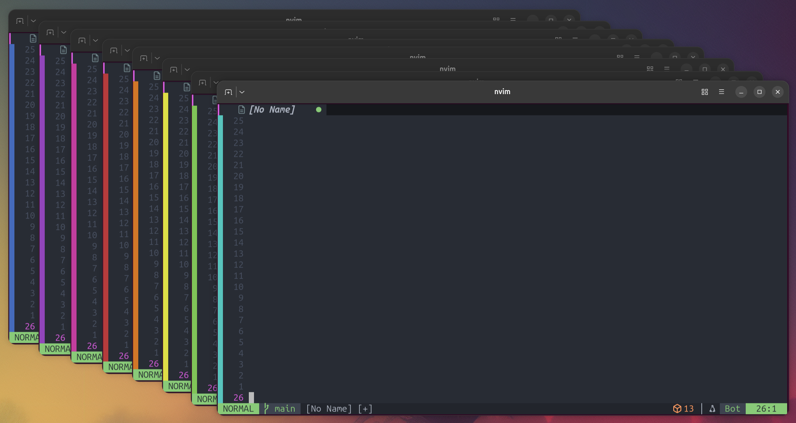

# 🌈 rainborders

Give every running Neovim instance its own color.

When you juggle several Neovim instances at once (multiple terminals, tmux
panes, splits in your window manager…), it's easy to lose track of which one
you're typing in. **rainborders** draws a colored vertical bar on the left edge
of each window, and every new instance automatically picks the next free color
in the palette — so each instance is instantly recognizable at a glance.



## Features

- 🌈 A distinct color per running Neovim instance, assigned automatically.
- ♻️ Colors are recycled: when an instance exits, its color becomes available
  again for the next one.
- 🎨 Fully customizable palette.

## Requirements

- Neovim **>= 0.10** (uses `vim.uv` and the `statuscolumn` option)
- A terminal with true color support (`termguicolors`) is recommended

## Installation

### [lazy.nvim](https://github.com/folke/lazy.nvim) / LazyVim

```lua
return {
  "vverdillon/rainborders",
  opts = {},
  config = function(_, opts)
    require("rainborders").setup(opts)
  end,
}
```

### Other plugin managers

Install `vverdillon/rainborders` with your plugin manager of choice, then call
`setup` somewhere in your config:

```lua
require("rainborders").setup()
```

## Configuration

`setup` accepts a single option, `colors`, a list of hex colors. Instances are
assigned colors in order; if more instances are running than there are colors,
the palette wraps around.

Default configuration:

```lua
require("rainborders").setup({
  colors = {
    "#456ABA", -- blue
    "#9145BA", -- purple
    "#C23E9E", -- pink
    "#B53C3C", -- red
    "#D17728", -- orange
    "#DEDE47", -- yellow
    "#80C458", -- green
    "#58C4BD", -- teal
  },
})
```

Example with a custom palette (lazy.nvim):

```lua
return {
  "vverdillon/rainborders",
  opts = {
    colors = { "#FF5555", "#50FA7B", "#BD93F9", "#F1FA8C" },
  },
  config = function(_, opts)
    require("rainborders").setup(opts)
  end,
}
```

Passing an empty `colors` table disables the plugin.

## Notes and limitations

- **rainborders overrides `statuscolumn`.** If you (or another plugin, such as
  `statuscol.nvim` or LazyVim's custom status column) already set
  `statuscolumn`, whichever runs last wins. The column rendered by rainborders
  is `%#VerticalBar#█%*%s%l ` (bar, signs, line number).
- The color is chosen once, at startup. It does not change while the instance
  is running, even if other instances exit.
- Instances are tracked per Neovim cache directory, so instances using a
  different `NVIM_APPNAME` have separate registries.

## License

[GPL-3.0](LICENSE)
